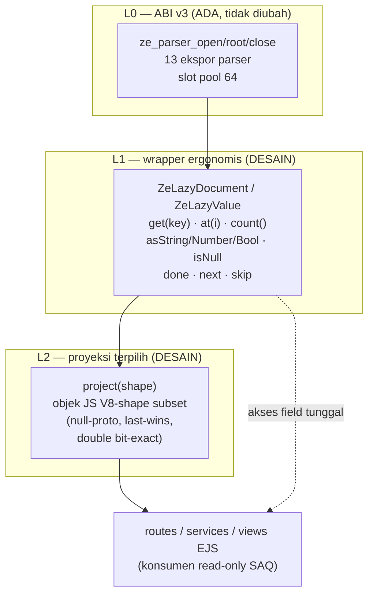
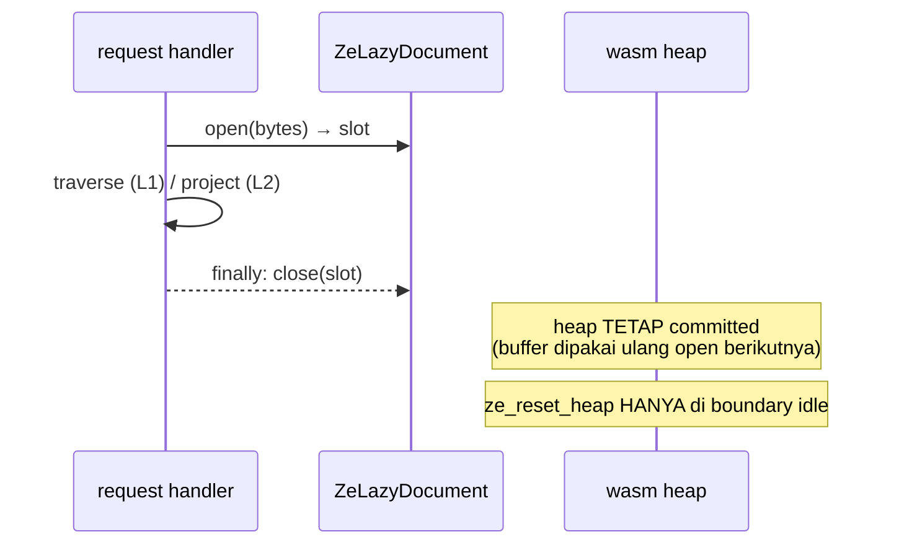

# Desain API Lazy-Access `ze_json` untuk Server SAQ (Stage 3 — ND-3)

> Deliverable Stage 3 dari direktif "Reorient ze_json Toward On-Demand JSON
> Parsing for SAQ Server Optimization" (pemilik, 2026-11-12). Dokumen ini adalah
> **desain, bukan implementasi** — implementasi minimal di ND-4, integrasi
> call-site di ND-5, benchmark acceptance di ND-6, kesimpulan di ND-7.
> Semua klaim tentang perilaku yang sudah ada bersumber file:line pada
> `ze_json` `d45beb7` dan `saq-report` `0340a72`; dasar audit:
> [`docs/research/audit-2026-11-12.md`](../research/audit-2026-11-12.md).
>
> Keputusan pemilik korpus (2026-11-12): **korpus tetap `saq_payload_v1`** —
> tidak diganti, tidak diregenerasi; Workload D memakai server `saq-report`
> asli + data store asli sehingga struktur real terjamin by construction.

Tanggal desain: 2026-11-12.

---

## 1. Prinsip & larangan (direktif §11)

1. **"Scan the structure once. Access only what is needed."** Struktur di-scan
   sekali per dokumen (`structural_scan` + bracket-match table,
   `src/ondemand/document.cpp:233-301`); setelah itu akses per-field on-demand.
2. **Materialisasi DOM penuh bukan jalur utama.** `ZeParser.parse()`
   (materialisasi penuh, `ze_json.mjs:595-622`) tetap ada sebagai **pembanding
   dan fallback**, bukan jalur konsumsi utama. Jalur utama = lazy (L1) +
   proyeksi terpilih (L2).
3. **Tanpa hash index default.** Key lookup = sekuensial dengan fast-compare
   byte mentah (§5). Klaim O(1) hanya boleh muncul bersama bukti ukur.
4. **Tanpa ekspor ABI baru tanpa bukti kebutuhan.** O1-11 (fusi step+kind
   ABI v4) terbukti netral 0.979–1.027× — setiap proposal ekspor baru
   (`ze_skip_value` dsb.) wajib lolos profil dulu (ND-4/ND-6).
5. **Satu perubahan per eksperimen; varian ditolak dipertahankan** (AGENTS §6).
6. **Baseline tidak diubah.** Server SAQ baseline (clone+join+view) dipertahankan
   apa adanya; integrasi lazy berada di sisi konsumen read-only yang dipilih
   (ND-5), dengan semantik aplikasi identik.

## 2. Arsitektur tiga lapis



| Lapis | Status | Peran |
|---|---|---|
| L0 ABI v3 | ada (`cabi.hpp:45-125`, `cabi.cpp`) | kontrak tetap; traversal stateless via frame `(cursor, token_start)` |
| L1 wrapper lazy | **desain ini** | kenyamanan di atas L0: key-by-name, index array, promosi scalar, skip eksplisit — semua stateless, tanpa alokasi per node |
| L2 proyeksi | **desain ini** | materialisasi **subset** V8-shape dalam satu pass — jembatan ke EJS/route yang butuh nilai JS nyata |

Motivasi pemisahan: audit SAQ (§5.3–5.4 audit) menunjukkan konsumen dibagi dua
kelas — (a) yang butuh **nilai JS nyata** untuk render EJS/join (wajib L2),
(b) yang cukup **statistik/hitung** (`.length`, filter id) — cukup L1.
Clone `MongoJsonRepository.read()` (`MongoJsonRepository.js:25,83-89`) adalah
H1: konsumen read-only tidak butuh snapshot deep-copy.

## 3. Semantik handle (L1)

### 3.1 Handle = frame, bukan objek per node

- `ZeLazyDocument` = slot (Document terbuka) + root frame. `ZeLazyValue` =
  pasangan `(ts, cursor)` + referensi slot — **dua Number, satu objek kecil**;
  tidak ada alokasi per node seperti jalur materialisasi.
- Semua metode re-entry stateless: kembalikan frame baru; frame lama tetap
  valid selama dokumen terbuka (walk protocol: tiap index dikunjungi sekali
  maju; gallop `first_index_at_or_after` menutup re-derivation dari posisi
  basi, `document.cpp:77-106`).
- `close()` melepas slot (`ze_json.mjs:584`); frame basi setelahnya = error,
  bukan undefined-behavior (ABI memvalidasi slot; `ze_value_kind` slot mati =
  Unknown).

### 3.2 Permukaan metode

| Metode | Implementasi L0 | Semantik |
|---|---|---|
| `type()` | `ze_value_kind` | 0..7 (`kOndemandNodeType`) |
| `count()` | `ze_count_elements` | index-walk framing; TIDAK memvalidasi isi anak |
| `at(i)` | loop `ze_container_begin` + `ze_array_next` ×i | akses sekuensial; i besar → pakai iterasi/proyeksi satu pass |
| `asString()` | `ze_get_string` (+retry `InsufficientBuffer` dst 2×) | decode P7-3 penuh, V8-locked |
| `asNumber()` | `ze_get_number` | double V8-parity (P7-2), bit-exact |
| `asBool()` / `isNull()` | `ze_get_bool` / `ze_is_null` | literal check |
| `beginArray()` / `beginObject()` | `ze_container_begin` | frame anak pertama; done = `kStepSentinel` |
| `next()` | `ze_array_next` / `ze_object_next` | maju satu elemen/field |
| `get(key)` | `ze_object_field` + fast-compare (§5) | **first-wins** (keputusan D1) |
| `skip()` | pola induk: jangan deref anak, lanjut iterator induk | O(log lebar) per skip via gallop; subtree TIDAK divalidasi |

### 3.3 Skip subtree (keputusan D3)

Skip **tidak butuh ekspor ABI baru**. Protokol walk yang ada sudah
menyediakannya: dapatkan frame anak (`objectField`/`containerBegin` — murah,
tanpa decode), lalu **jangan masuk** — umpankan frame anak langsung ke
`objectNext`/`arrayNext` induk (`cabi.hpp:74-85`; jalur ini dipakai harness
`wasm-walk-full`). Biaya lompat satu subtree ≈ satu gallop
O(log jarak-koma), bukan O(ukuran subtree).

Kandidat bersyarat `ze_skip_value` (jump langsung ke closer via match table)
hanya masuk implementasi bila profil ND-4/ND-6 menunjukkan langkah
dapatkan-frame + gallop itu dominan — dengan peringatan O1-11 (manuver ABI
tambahan bisa netral). Test identitas skip sudah ada di sisi C++
(`value_test.cpp:277,302` — `SkippedSubtreeStaysUnvalidated`,
`DeepSkipIsIterative`); lapisan JS wajib meniru test yang sama.

## 4. Lifetime slot & bump-heap untuk server (keputusan D2)

### 4.1 Realita saat ini

- Pool statis 64 slot (`kParserSlotMax`, `cabi.hpp:131`); `ze_parser_open`
  carve arena `3×src_size×8 + 64` byte dari bump heap (`cabi.hpp:57-61`).
- `ze_reset_heap` menutup **SEMUA** slot lalu rewind heap
  (`cabi.hpp:65-67`; `ze_json.mjs:154-157`) — kontrak batch, tidak boleh
  dipanggil saat handle hidup.
- `dst` decode buffer tumbuh 2× per `InsufficientBuffer`
  (`ze_json.mjs:634-648`); tidak ada free per-node.

### 4.2 Model yang diusulkan: akuisisi-per-request, release-di-`finally`



1. **Satu slot per dokumen yang dibuka dalam satu handler**; open → traverse →
   close dalam `try/finally`. Konsumen SAQ mayoritas membaca repo **sekuensial**
   (tiap `repo.read()` selesai sebelum berikutnya — single-threaded) → satu
   slot cukup di-reuse berulang; dashboard yang butuh 6 repo tetap ≤2 slot
   hidup serentak (pola: baca repo A → project → close → baca repo B).
2. **Bila pool habis (64): gagal-loud** — `ze_parser_open` mengembalikan
   `InsufficientBuffer` (`cabi.hpp:59-61`); lapisan JS melempar `ZeParserError`
   → handler SAQ 500/503 standar. Tanpa eviksi diam-diam (silent eviction
   = sumber kebocoran semantik). Kebutuhan real diperkirakan jauh di bawah 64;
   monitor lewat record ND-6.
3. **`ze_reset_heap` hanya di boundary idle** (antara request di event loop
   kosong, atau sebelum batch benchmark berikutnya). Buffer heap
   committed dipakai ulang open berikutnya — alokasi steady-state ≈ nol.
4. **Ukuran**: payload SAQ ratusan KB → arena ~24×payload + src/dst;
   dokumen ~1 MiB butuh ~28 MiB linear memory → **satu dokumen besar per
   waktu**; dua dokumen 1 MiB serentak mendekati batas 64 MiB. Kebijakan:
   payload besar = slot tunggal serial (diukur ulang di ND-6; korpus SAQ jauh
   di bawah ini).
5. **Non-tujuan saat ini**: pool dinamis / ekspor "close satu slot +
   kembalikan areanya" — bump heap tidak punya free individual; desain ini
   sengaja tidak menambalnya sampai profil membuktikan perlu.

## 5. Key lookup by name — `get(key)` (keputusan D1)

### 5.1 Algoritma

```
get(key, frame_object):
  for field in iterate_object(frame_object):        # sekuensial, maju
    span = raw key bytes (tanpa decode)             # StringSpan.start/total_len
    if span.len == key.len and memcmp(span, key) == 0:
        if span.escaped: decode + verifikasi match  # kasus jarang
        return ZeLazyValue(field.value_frame)       # early-exit
  return undefined                                  # key absen
```

- Fast-compare byte mentah: bandingkan panjang + isi span **tanpa decode**;
  decode hanya (a) saat match dan key ber-escape, (b) saat key DIBACA
  (bukan dibandingkan). Korpus SAQ: key ASCII plain semua → jalur cepat.
- **Tanpa klaim O(1)**: biaya = O(jumlah field dalam container) per panggilan,
  sekuensial. Hash index dilarang default (§1); bila ND-6 membuktikan lookup
  berulang pada container lebar jadi bottleneck, alternatif yang diuji tetap
  bukan hash, melainkan **proyeksi satu-pass** (L2) yang mengekstrak banyak
  field sekaligus.

### 5.2 Keputusan duplikat-key: first-wins di `get()`, last-wins di L2

| Jalur | Semantik duplikat | Alasan |
|---|---|---|
| `get(key)` (L1) | **first-wins** (early-exit) | biaya lookup konstan-kecil; melanjutkan scan demi last-wins menghilangkan early-exit |
| `project(shape)` (L2) | **last-wins** (`obj[key] = value` berulang) | parity penuh dengan V8 `JSON.parse` dan `#materialize` (`ze_json.mjs:713-714`) |
| `parse()` (ada) | last-wins | pembanding, tidak diubah |

Divergensi first-wins `get()` **eksplisit dan terdokumentasi**: data SAQ tidak
menyandikan key duplikat (semua penulisnya array-of-object unik — generator
korpus dan route penulis). Differential test (§10) mengunci kedua perilaku
dengan fixture duplikat, sehingga bila kelak data real berubah, test pecah
sebelum klaim parity salah. **Bila Workload D membuktikan ada duplikat pada
jalur yang memakai `get()`, keputusan ini wajib direview** (ganti ke
last-wins atau naikkan ke L2).

### 5.3 Akses berulang (concern P4-3 — tetap open)

`get()` berulang pada container yang sama = re-scan berulang (deterministik,
`value.hpp:51-57`). Desain ini **sengaja tidak menambahkan cache** — konsumen
SAQ pola dominannya adalah "satu pass, banyak field" → solusi kelas L2.
Cache per-node jadi eksperimen terpisah bila profil membuktikan perlu.

## 6. Proyeksi termaterialisasi terpilih — `project(shape)` (L2)

### 6.1 Kontrak

- Input: shape descriptor — path/daftar field per tingkat; mendukung:
  root array → map item-shape; field nested; field array-of-scalar.
- Output: objek/nilai JS **V8-shape** untuk subset itu:
  - `Object.create(null)` + assignment berulang → **last-wins**;
  - double **bit-exact** (`ze_get_number` 8-byte LE, `cabi.hpp:94-99`);
  - string **decode penuh** P7-3 (V8-locked; lone-surrogate passthrough
    terdokumentasi, `ze_json.mjs:419-433`);
  - key absen → **properti absen** (bukan `null`) → fallback `??` konsumen
    identik dengan hasil `JSON.parse` dokumen yang sama;
  - array → `[]` urutan sumber.
- Satu pass traversal: tiap field dokumen dikunjungi ≤1× untuk satu proyeksi
  (tambahan gallop hanya pada framing); subtree di luar shape di-**skip**
  (§3.3) — di situlah penghematan versus `JSON.parse`/clone penuh.

### 6.2 Pemetaan konsumen SAQ → bentuk proyeksi (dari audit §5.3–5.4)

| Konsumen | Kebutuhan riil | Bentuk |
|---|---|---|
| GET `/rekap` (`rekapRoutes.js:26-31`) | 4×`.length` saja | proyeksi trivial: 4 angka, tanpa decode field lain |
| Dashboard (`dashboardService.js:33-193`) | `reports.length`, filter minggu berjalan, status `'hadir'/'libur'/'pengganti'` | proyeksi field terpilih + hitung di JS |
| `getEnrichedReports` (`scheduleService.js:33-50`) | join per report: `schedule_id` → schedule/course/lecturer + `assistant_ids` | proyeksi 4 collection dalam 4 pass sekali per request (bukan clone 5× per pass) |
| Rekap grid (`attendanceService.js:122-292`) | fields schedules/reports tertentu + `ttd_image`, `NIM` | shape per payload type |
| Status WA / cron (`whatsappRoutes`, `cronService`) | `schedules` hari/jam + `pj_assistant_id`, config `system.cron_time` | proyeksi kecil |

Nama field proyeksi memakai **struktur real saq-report** (`ttd_image`, `NIM`,
`semester.months/name`, `system.*`, status semantik) — keputusan pemilik
korpus tidak mengubah target implementasi: korpus A–C tetap `saq_payload_v1`
(biaya kelas sama), sedangkan validasi kebenaran jalur lazy dijalankan pada
**data store asli server** di Workload D.

### 6.3 Batas eksplisit proyeksi

- Proyeksi BUKAN pengganti write-path: handler yang memutasi lalu `write()`
  tetap pakai clone V8 (`H5` — stringify tetap V8). Lazy hanya untuk
  **konsumen read-only** (H1).
- EJS menerima objek JS biasa — hasil proyeksi kompatibel 1:1 (semantik
  `??`, `||`, `Array.includes` identik).

## 7. Error model

| Sitasi kejadian | Perilaku |
|---|---|
| Verdict ABI ≠ ok (`code<<32`) | `ZeParserError` (sudah ada, `ze_json.mjs:405-407`) — throw di titik akses |
| Iterator sticky error (malformed di subtree **yang dikonsumsi**) | error dikirim ke frame berikutnya; akses berikutnya throw — konsisten C++ (`value.hpp:141,181`) |
| Subtree di-skip berisi malformed | **tidak pernah error** (kontrak on-demand; test `SkippedSubtreeStaysUnvalidated`) |
| Key absen (`get`) | `undefined` (bukan throw) — parity konsumen `??` |
| Key absen (project) | properti absen |
| Pool habis (`ze_parser_open` `InsufficientBuffer`) | `ZeParserError` → handler 500/503; tanpa eviksi diam-diam |
| Slot sudah di-`close` lalu dipakai | `ze_value_kind` → Unknown / step error → throw di titik akses (bukan UB) |
| `JSON.parse(raw_json)` admin (`settingRoutes.js:126`) | **tidak disentuh** — tetap V8 |

## 8. Boundary & divergensi terdokumentasi

1. **Lone-surrogate escape**: passthrough verbatim di decode P7-3
   (`ze_json.mjs:419-433`) — identik di L1/L2; payload SAQ praktis tidak
   memakainya; parity test tetap dijalankan di korpus.
2. **64 MiB linear memory** (memory64 tanpa grow): kebijakan §4.2-4; payload
   jauh di bawah; dicatat sebagai limitasi ND-7 bila payload masa depan besar.
3. **Duplikat key**: divergensi first-wins `get()` vs last-wins V8 (§5.2) —
   terkunci test.
4. **Forward-only**: tidak ada back/peek acak; `at(i)` = stepping. Konsumen
   yang butuh akses berulang = proyeksi satu pass.
5. **UTF-8/grammar**: divalidasi saat scalar dipromosi (P7-3/P7-2) atau saat
   framing dikonsumsi; subtree tak-dikonsumsi tidak divalidasi — perilaku
   identik dengan sisi C++ yang sudah teruji.

## 9. Yang eksplisit TIDAK didesain di dokumen ini

- Hash index / random access O(1) tanpa bukti (larangan §11).
- DOM penuh sebagai jalur utama; `parse()` tetap ada untuk pembanding.
- Perubahan `MongoJsonRepository` write path / `exportService` stringify (H5).
- Pool slot dinamis, free-per-slot, GC arena.
- Schema/validator JSON; validasi total dokumen (kontrak on-demand).
- Integrasi call-site konkret & benchmark (ND-5/ND-6) — desain di sini hanya
  menyediakan permukaan API + semantik yang akan dipakai keduanya.

## 10. Rencana uji untuk implementasi (input ND-4)

| # | Uji | Kriteria |
|---|---|---|
| T1 | Differential proyeksi: `project(shape)` vs `JSON.parse` (V8) di korpus (termasuk `checker_batch` edge docs) | subset struktur identik (deep-equal) untuk semua dokumen |
| T2 | Duplikat-key fixture: `{a:1,a:2}` | `get('a')` = 1 (first-wins); `project` = 2 (last-wins) — keduanya terkunci |
| T3 | Lifetime: open/close >64 dokumen berulang; slot reuse; pool habis; `close` ganda | tidak ada kebocoran slot; error fail-loud; heap steady |
| T4 | Skip: traversal dengan skip di tengah array/object panjang + subtree malformed yang di-skip | hasil identik dengan jalur tanpa-skip pada bagian yang dikonsumsi; malformed di-skip tidak pernah error |
| T5 | `at(i)` dan `count()` vs V8 pada array besar | nilai identik; biaya tercatat di record (bukan klaim) |
| T6 | String/number edge (escape, unicode, angka batas, `-0`, subnormal) | parity V8 bit-exact |
| T7 | `native-sanitize` + differential C++ existing tetap hijau (tidak menyentuh C++) | regress 0 |

Semua record hasil ukur membawa `rationale` + `@cite`
(10.1002_spe.3313 on-demand JSON; 10.14778_3115404.3115416 Mison) per AGENTS §4.

## 11. Kaitan acceptance (ND-6)

- Fase **C** (deep selective) dan **D** (workload SAQ asli) mengukur jalur
  L1/L2 ini vs baseline V8/clone pada boundary yang identik; target
  `T_baseline / T_ze ≥ 1.5×` di fase D. Bila gagal → bukti bottleneck
  diberikan, bukan hasil yang dimanipulasi.
- Metrik skema v2 (median, P95, alloc count, index count, consumed/skipped)
  dipakai untuk memisahkan kontribusi: open (arena) vs traversal vs decode
  vs boxing JS.

---

# Bagian as-built (pasca-implementasi)

## 12. Catatan as-built Stage 4 (ND-4, ze_json PR #31 `defd452`)

Implementasi mengikuti desain §3–§8 dengan **empat deviasi as-built** —
semuanya di sisi JS, tanpa perubahan ABI v3:

1. **`ZeLazyDocument` dihapus dari permukaan.** Desain memisahkan
   `ZeLazyDocument` (dokumen) dan `ZeLazyValue` (node); implementasi memakai
   metode pada `ZeParser` (`get/at/lazy/project/sourceView/materializeAt`)
   + class `ZeLazyValue`. Alasan: `ZeParser` sudah memiliki slot + frame
   root — class dokumen terpisah jadi duplikasi state; reuse `#materialize`
   oleh `project()`/`materializeAt()` menjamin parity semantik dengan
   `parse()` secara konstruk. Tidak ada perilaku desain yang hilang.
2. **Semantik frame key: `cursor == posisi quote pembuka`, bukan posisi
   `:`.** Desain §5.1 berasumsi span key bisa diturunkan dari
   `(ts, cursor)`; implementasi membuktikan frame key membawa
   `cursor == ts` (verifikasi `containerBegin` → `{ts:1, cursor:1}` pada
   `{"u":...}`) sehingga **span key mentah diturunkan dengan walk
   skip-pair** dari source view (akhir token = `"` pertama yang tak
   ter-escape; `\u0022` tak pernah memecah span). Biaya tetap
   O(len key) — kelas biaya yang sama dengan desain; fast-compare byte
   mentah untuk key bebas-escape tetap berlaku (D1 tidak berubah).
3. **Escape-path `get()`/`project()`**: key ber-escape didecode sekali dan
   dibandingkan ke needle (bukan "decode saat match" dari desain §5.1 —
   klausul itu memerlukan decode terlebih dahulu untuk MENENTUKAN match;
   bentuk implementasi lebih sederhana dan semantik identik: raw-equal
   tapi ter-escape TIDAK pernah match). T2 mengunci kedua perilaku.
4. **Tidak ada ekspor ABI baru** — skip subtree (D3) berjalan persis lewat
   protokol induk (frame anak → `objectNext`/`arrayNext` induk);
   `ze_skip_value` tidak diperlukan oleh profil awal (lihat §13).

Permukaan final (`ze_json.mjs`): `ZeParser.{get,at,lazy,project,
sourceView,materializeAt}` + `ZeLazyValue.{type,count,at,get,entries,
items,asString,asNumber,asBool,isNull,value}`. Grammar shape `$count`/
`$array`/object-shape sesuai §6.1 (termasuk key absen = properti absen,
duplikat last-wins, null-proto target). Test as-built: `tests/lazy.mjs`
43 checks (T1–T6 hijau; smoke + differential tetap hijau = T7).

## 13. Laporan Stage 4 — temuan probe preliminary (bukan record)

Sumber: `ze_json/bindings/js/benchmarks/lazy_probe.mjs` (dev device,
single process, median 11 ronde, warmup 3 rep, tanpa alternating —
**PRELIMINARY, bukan angka skripsi**; record tervalidasi di ND-6).
Dilaporkan apa adanya (larangan manipulasi boundary §11).

| Dokumen (bytes) | V8 parse | ze `parse()` | ze selective | ze L1 id-scan |
|---|---|---|---|---|
| `synthetic_10k` (10 KB) | 0.058 ms | 0.06× | **1.57×** | **1.36×** |
| `synthetic_100k` (100 KB) | 0.635 ms | 0.06× | **2.42×** | **2.47×** |
| `synthetic_1mb` (1 MB) | 6.35 ms | 0.07× | **2.52×** | **2.81×** |
| `saq schedules` (39 KB) | 0.089 ms | 0.04× | 0.08× | **1.56×** |
| `saq reports` (35 KB) | 0.072 ms | 0.05× | 0.14× | 0.32× |
| `saq courses/lecturers` (~4 KB) | ~0.009 ms | 0.04× | 0.08× | ~1.0× |

(rasio = waktu baseline / waktu jalur ze; bold = ze lebih cepat.)

**Temuan:**

1. **Full materialisasi via binding = 14–25× di bawah V8** (10–25 MB/s
   vs 160–500 MB/s). Premis direktif terkonfirmasi: satu-satunya jalur
   viable untuk SAQ adalah lazy/selective; `parse()` tetap pembanding.
2. **Selective/L1 menang di dokumen ≥10 KB**: 1.36–2.81× pada korpus
   sintetis. `project(shape)` subset + L1 id-scan membayar hanya field
   yang diakses — penghematan tumbuh seiring ukuran dokumen.
3. **Di ukuran SAQ, biaya per-panggilan ABI mendominasi**: boxing BigInt
   ~0.4–0.8 µs per ekspor (3–5 arg) ≈ 2 panggilan per field yang
   di-visit (`objectField` + `objectNext`). Konsekuensi:
   `reports.json` (60 item, scan field berurutan) kalah 0.14–0.32×;
   `schedules.json` menang 1.56× via L1 karena cost open
   (copy + structural scan + carve arena ~25–50 µs) < full-parse V8.
4. **Implikasi untuk ND-5/ND-6** (dipakai sebagai input hipotesis, bukan
   keputusan): acceptance 1.5× di Workload D memerlukan (a) call-site
   yang meng-visit sedikit field per dokumen (early-exit, id-scan), atau
   (b) pengurangan overhead per-panggilan — kandidat: batch export /
   proyeksi C++-side satu-panggilan (ABI v4) — **wajib diukur dulu**
   (peringatan O1-11: manuver ABI tambahan bisa netral). ND-6 wajib
   memprofilkan kontribusi open vs traversal vs boxing sebelum keputusan.

## 14. Catatan as-built Stage 5 (ND-5, saq-report PR #3 `7930009`)

Integrasi call-site read-only pertama: **GET `/rekap`** (stats 4 repo).
Desain §2–§6 berlaku dengan deviasi as-built berikut:

1. **Jalur opt-in, bukan penggantian**: flag env `SAQ_JSON_ENGINE=ze`
   mengaktifkan jalur ze di route `/rekap` saja; default = baseline V8
   byte-identical (`read().length`). Desain §4.2 (akuisisi slot
   akuisisi-per-request + release-di-`finally`) tidak dipakai apa adanya —
   untuk kebutuhan count yang murni sinkron, dipakai pola **sole-owner**:
   `open → count → close → resetHeap` dalam satu fungsi sinkron
   (`countJsonBytes`), atomik terhadap event loop, sehingga `resetHeap`
   tidak pernah mematikan slot parser hidup milik handler lain. Pool
   bersama (§4.2) tetap dibuka untuk stage lanjutan bila call-site
   perlu menahan handle lintas await.
2. **Loader CJS, bukan ESM import**: server saq-report CommonJS — binding
   ESM `ze_json.mjs` dimuat via `require(esm)` (Node ≥ 22.12 unflagged,
   stabil di Node 24) di `repositories/zeJsonBinding.js`; path binding
   bisa dioverride `ZE_JSON_BINDING_PATH`. Tanpa ABI baru: frame key
   `(ts, cursor)` + `get()/countElements()/getString()/kind()` (protokol
   induk dari Stage 4, ABI v3 apa adanya).
3. **`readCount()` baru, `read()` tidak disentuh**: `JsonRepository`
   (file store) dan `MongoJsonRepository` (cache) masing-masing menambah
   method `readCount()`; baseline `read()`/`write()` byte-identical.
   Semantik `.length` aplikasi diparity-kan penuh, termasuk dua jebakan
   yang baru ketahuan saat gate:
   - **Nullish coalescing trigger pada null, bukan hanya undefined**:
     `json[rootKey] ?? default` saat field bernilai `null` menghasilkan
     `default` (bukan `null`) → `.length` default. Implementasi awal
     mengembalikan `undefined` — diperbaiki menjadi
     `valueLength(defaultValue)`.
   - **Lokasi error menjadi bagian parity**: root `null` dengan rootKey
     melempar TypeError **di dalam `read()`** baseline (tertangkap
     try/catch) → AppError 500; tanpa rootKey, TypeError `null.length`
     terjadi **di call-site** (di luar `read()`) → tetap TypeError.
     `readCount()` mereplikasi keduanya: TypeError dari jalur rootKey
     dibungkus AppError, TypeError jalur root-tanpa-rootKey diteruskan.
4. **Cache Mongo = nilai unwrapped**: `rootKey` sudah diterapkan saat
   seed, sehingga `MongoJsonRepository.readCount()` menghitung root
   langsung (`countJsonBytes(bytes, null)`), bukan lookup rootKey —
   deviasi dari mental model file store; fallback sebelum `init()`
   didelegasikan ke `seedRepo.readCount()`.
5. **Gate parity fungsional 26/26** (`scripts/check-json-lazy-parity.js`):
   6 file store (korpus `saq_payload_v1`, provenance P0-8 — file runtime
   tidak ter-commit), 6 cache Mongo disimulasikan (`_cacheLoaded=true`,
   tanpa MongoDB), 2 kasus file hilang, 12 edge semantik (field
   null/string/number/bool/object, key absen, root
   array/object/string/null×2). Semua nilai + jenis & lokasi error
   identik dengan baseline. Duplicate-key terkunci di level binding
   (`tests/lazy.mjs` T2, first-wins) — data store SAQ tidak menyandikan
   duplikat.
6. **Scope**: SATU call-site (stats `/rekap`) sesuai keputusan pemilik;
   dashboard/enrichment menyusul pasca benchmark ND-6 (hipotesis §13.3:
   pada dokumen ~4–39 KB, biaya open + boxing ABI bisa mendominasi —
  Workload B/C/D yang memutuskan, bukan penambahan call-site).

