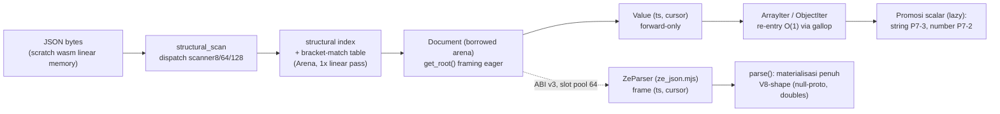
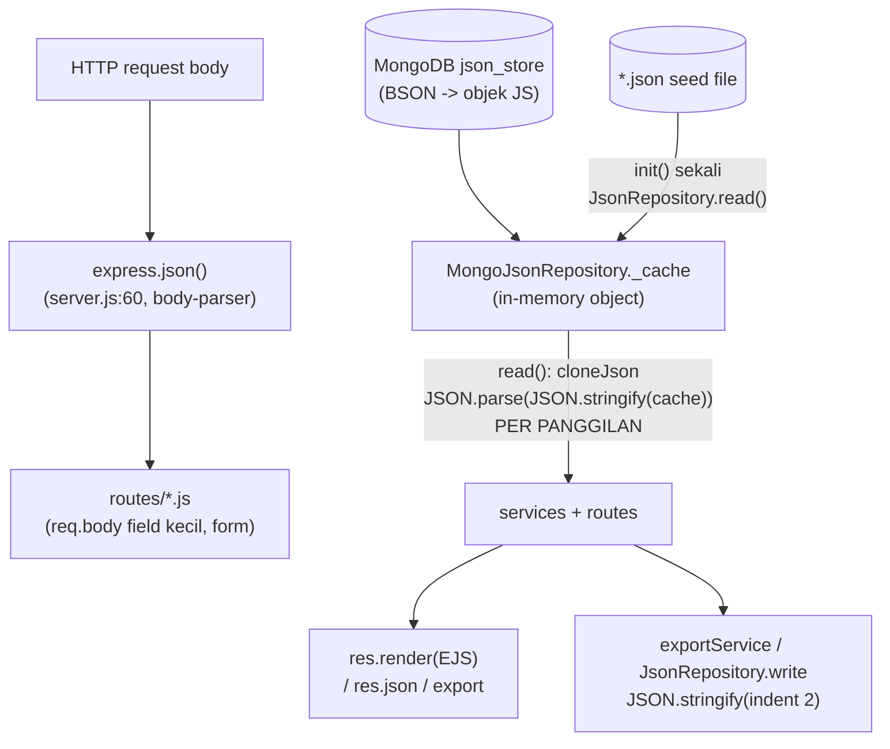

# Audit Arah On-Demand — kondisi aktual tiga repo (Stage 1)

> Deliverable Stage 1 dari direktif "Reorient ze_json Toward On-Demand JSON Parsing
> for SAQ Server Optimization" (pemilik, 2026-11-12). Audit ini murni inspeksi
> source code — **source adalah satu-satunya sumber kebenaran** — tanpa perubahan
> kode. Setiap temuan membawa path:line, simbol, perilaku aktual, dan implikasi
> performa. Dokumen ini adalah input wajib untuk Stage 2 (koreksi dokumentasi),
> Stage 3 (desain API lazy), dan Stage 4–6 (implementasi + benchmark).

Tanggal audit: 2026-11-12.
State yang diaudit (semua bersih kecuali file milik pemilik yang tidak disentuh):

| Repo | SHA | Cabang |
|---|---|---|
| `v5` (thesis) | `87fcf5a` | `main` (PR #42 merged) |
| `ze_json` | `c1c91ce` | `main` (PR #29 gallop merged) |
| `saq-report` | `0340a72` | `main` |

> **Revisi Stage 2 (2026-11-12)**: klaim "`scanner32` tak pernah eksis" pada
> §3.4, §6, dan §8 di bawah **keliru** — stub 32-bit eksis (deklarasi
> `scanner.hpp:28-32`, stub `parallel.cpp:135-147` return `InvalidJson`).
> Ditambah temuan baru: catatan "`npm-publish.yml` STALE" di AGENTS.md sendiri
> usang (workflow sudah disinkronkan — §8). Koreksi bersumber verifikasi
> source pada HEAD `c1c91ce` sebelum edit dokumen Stage 2.

---

## 1. Ringkasan eksekutif

1. **Lapisan on-demand C++ sudah terimplement dan teruji** — bukan TODO.
   `Document`/`Value`/`ArrayIter`/`ObjectIter` + scanner struktural + bracket-match
   table + gallop lookup hidup di `ze_json/include/ze_json/ondemand/` dan
   `src/ondemand/`, dengan 75 TEST gtest di 6 target dan 4 benchmark native fase
   (reference/open/walk-only/full-walk). Catatan lama "parser on-demand masih
   TODO" (AGENTS.md §1) **usang**.
2. **Binding JS sudah punya dua jalur**: `ZeParser` (lazy, slot+cursor, ABI v3)
   dan `ZeParser.parse()` (materialisasi penuh V8-shape). Klaim "binding hanya
   full materialization" tidak lagi benar. Yang **belum ada** adalah API lazy
   level-kegunaaan (akses key-by-name, index array, skip eksplisit) — pemakai
   lazy harus menggerakkan frame `(ts, cursor)` manual (hanya dipakai harness).
3. **Belum ada benchmark fase selective-access** — baik native
   (`BM_ParseOnDemand*` semua fase konsumsi penuh) maupun Node (konteks
   `wasm-open`/`wasm-walk-full`/`wasm-parse-full` semua konsumsi penuh). Fase C
   (deep selective) dan D (workload SAQ asli) dari direktif belum ada.
4. **Hot path JSON SAQ bukan `JSON.parse` body** — yang dominan adalah
   `MongoJsonRepository.read()` yang melakukan **clone `JSON.parse(JSON.stringify(cache))`
   penuh per panggilan** (`MongoJsonRepository.js:27,83-89`), dipanggil 4–10× per
   request view (dashboard 6 repo; `/rekap/asisten` ≈10 siklus; `/rekap` 4 repo
   hanya untuk `.length`), plus amplifikasi join O(n×m) per request tanpa cache.
   `express.json()` hanya menyentuh body form kecil; `exportService` mendominasi
   jalur stringify.
5. **Korpus `saq_payload_v1` punya gap fidelity terhadap aplikasi nyata** —
   status laporan, nama field TTD, `NIM`, `semester.months/name`, `system.*`, dan
   `assistant_ids` kosong untuk ≥79% schedules. Workload D di korpus ini akan
   menghasilkan nilai aplikasi yang berbeda dari deployment nyata; perlu korpus
   v2 (keputusan pemilik).
6. **Skema record v1 belum membawa metrik yang disyaratkan direktif** (median,
   P95, alloc count, index count, consumed/skipped fields) — ada slot `extras`
   bebas, tetapi Stage 6 perlu memperluas skema atau menuliskannya di extras.

---

## 2. Metode & standar bukti

- Inspeksi langsung file source ketiga repo (daftar file di tiap seksi).
- Bukti pengukuran yang disitir semuanya record tervalidasi
  (`scripts/measurement-schema/validate.py` PASS): run segar 2026-11-12
  `zuu-20261112010521-0340a72` (V8), `zuu-20261112010545-c1c91ce` + kontrol
  `zuu-20261112010605-c1c91ce` (post-O1), `zuu-20261112010554-ab09adb`
  (pre-O1), plus exhibit di `out/raw/`. Record tanpa validasi tidak dipakai.
- Angka native bersifat historis dan diberi tanda (kode native berubah sejak
  run terakhir `ca8f5f4`, 2026-11-09 — re-run native belum dilakukan).

---

## 3. Status arsitektur ze_json (as-built)

### 3.1 Peta lapisan

File kunci (semua di `ze_json/`):

| Lapisan | File | Isi aktual |
|---|---|---|
| Kontrak ABI | `include/ze_json/abi/cabi.hpp` | v3 (line 126); tabel ekspor scanner (v2) + 13 ekspor parser (v3, line 45–108); `kParserSlotMax=64` (131); packing ok/step/error (110–124) |
| ABI impl | `src/abi/cabi.cpp` | slot pool statis Arena+Document di bss (42–57), `frame_value` rekonstruksi C++ iterator dari pasangan `(cursor, ts)` (71–79), bump allocator tanpa free (95–104) |
| Scanner | `src/ondemand/scalar.cpp` (scanner8), `src/ondemand/parallel.cpp` (scanner64 SWAR line 33, scanner128 simd, scanner32 stub line 138) | scanner8 pemenang terukur (P4-2); `structural_scan` = dispatch statis; scanner32 = stub 32-bit (return `InvalidJson`) |
| On-demand | `include/ze_json/ondemand/{document,value}.hpp`, `src/ondemand/document.cpp` | lihat §3.2–3.3 |
| Scalar | `src/ondemand/{string,number}.cpp` | P7-3 unescape (V8-locked lone-surrogate passthrough), P7-2 double (V8-parity) |
| Binding | `bindings/js/ze_json.mjs` | `ZeJson` low-level + `ZeDocument` (scan) + `ZeParser` (lazy frame + `parse()` penuh) |
| Test | `tests/` (6 target, 75 TEST) | scanner differential + json_checker; number/string V8-parity; value/document framing & skip; reference parser invariants |
| Benchmark native | `benchmarks/parser_benchmark.cpp` | `BM_ParseReference`, `BM_ParseOpen`, `BM_ParseOnDemandWalkOnly`, `BM_ParseOnDemandFullWalk` per korpus (register_corpus:403–429, reps 5) |

### 3.2 Struktural scan & index (fondasi on-demand)

- `Document::open` (`src/ondemand/document.cpp:233-301`): scan struktural **sekali**
  (`structural_scan`, line 259) + **bracket-match table** via LIFO pairing
  type-aware (line 270–295); bracket silang `[ { ] }` ditandai `kNoBracket`
  (bukan error) dan menjadi framing violation di konsumen.
- Alokasi open: **3 blok arena × `src_size * 8` byte** (indexes, match, stack;
  line 249–255) — worst case ~24 byte per byte sumber. Untuk korpus ≤1 MiB:
  ~24 MiB index + ~2×(src+dst) scratch di 64 MiB linear memory.
- `get_root` framing eager: opener harus `indexes_[0]`, closer match harus index
  terakhir, trailing hanya whitespace (line 319–332) — boundary dokumen
  terjamin, isi container belum divalidasi (kontrak on-demand).

### 3.3 Kapabilitas on-demand yang SUDAH ada (Pertanyaan audit #1)

| Kapabilitas | Bukti | Status |
|---|---|---|
| Buka dokumen = structural index sekali | `document.cpp:233-301` | ✅ |
| Klasifikasi tipe tanpa materialisasi | `value.hpp:46` + `document.cpp:361` (`classify` via tabel launcher) | ✅ |
| Promosi scalar lazy (string/double/bool/null) | `value.hpp:58-63`; impl `src/ondemand/{string,number}.cpp` | ✅ (full grammar + UTF-8 saat akses) |
| Traversal array/object forward-only | `value.hpp:115-182`; impl `document.cpp:410-536,556-701` | ✅ |
| `count_elements` tanpa materialisasi (index-walk) | `value.hpp:87-88`, `document.cpp:483+` | ✅ |
| Skip subtree via match table | `document.cpp:270-295` + test `value_test.cpp:277,302` (`SkippedSubtreeStaysUnvalidated`, `DeepSkipIsIterative`) | ✅ internal |
| Re-entry O(1) dari frame + gallop fallback | `first_index_at_or_after` (`document.cpp:77-106`, O(log d), dipakai di 10 situs: framing koma 173/220, begin_array 418/432, begin_object 454/468, ObjectIter 647/664) | ✅ (O1-8, diterima) |
| Error model konsistent | `core::JsonErrc` + sticky error iterator (`value.hpp:141,181`) | ✅ |
| Ekspos ke JS (frame stateless slot+cursor) | ABI v3 + `ZeParser` | ✅ |

### 3.4 Kapabilitas yang BELUM lengkap (Pertanyaan audit #2)

1. **Tidak ada key-lookup by name** di C++ (`Value`/`ObjectIter` hanya maju;
   `value.hpp` tak memuat `find`/`get`). Lookup JS harus dekode tiap key untuk
   membandingkan (lihat §3.5). Key yang di-escape wajib didekode penuh sebelum
   compare (key token `StringSpan` punya flag `escaped`, `value.hpp:31-35`).
2. **Tidak ada primitif "skip lalu lanjut" publik** — untuk melewati subtree,
   pemakai JS tidak menderef anak lalu `objectNext`/`arrayNext` dari frame anak
   (jalan normal), tetapi tidak ada ekspor ABI "lompat ke closer via match
   table". `count_elements` memang index-walk, tetapi mahal untuk skip murni.
3. **Akses acak array = stepping** — `at(i)` tidak ada; i langkah `arrayNext`.
4. **Akses berulang re-promosi** — tanpa cache arena (`value.hpp:51-57`
   mendokumentasikan ulang-scan deterministik; concern P4-3 masih open).
5. **Slot pool 64 + bump heap tanpa free** — server jangka panjang butuh rencana
   lifetime per-request (`ze_reset_heap` menutup SEMUA slot — `ze_json.mjs:154-157`,
   `cabi.cpp:118-120`). Kontraknya cocok untuk benchmark batch, belum untuk server.
6. **`parallel.cpp` = scanner64/128 terukur + scanner32 stub** — stub 32-bit
   (`parallel.cpp:135-147`, return `InvalidJson`, deklarasi
   `scanner.hpp:28-32`); bukan varian terukur, hanya symbol 32-bit.
   (Revisi Stage 2: kalimat awal "scanner32 tidak ada" keliru.)
7. **Koreksi referensi direktif**: kelas `Document/Value/ArrayIter/ObjectIter`
   adalah nama aktual; `reference_parser.hpp` = reference implementation
   (diferensial), bukan API konsumen.

### 3.5 Granularitas & biaya per-call C-ABI (Pertanyaan audit #4)

Jalur materialisasi penuh per dokumen (dari `ze_json.mjs #materialize:608-622`,
`#readObject:692-738`, `#readArray:650-690`):

| Operasi | ABI call per unit |
|---|---|
| Klasifikasi tipe | `ze_value_kind` ×1 per value |
| Masuk container | `ze_container_begin` ×1 per container |
| Field object | `ze_object_field` ×1 + `ze_object_next` ×1 + decode key (`ze_get_string` ≥1) |
| Elemen array | `ze_array_next` ×1 (+1 kind) |
| Scalar | `ze_get_number`/`ze_get_string` ×1 (+retry InsufficientBuffer untuk string panjang) |

≈ 3–4 panggilan ABI per field object + 2 per elemen array + 1 per scalar, dan
**setiap panggilan step mengemas/lepas-masuk `BigInt`** (`#frame`/`#plain`:
`BigInt.asUintN` + shift + `Number`, `ze_json.mjs:213-244`) — boxing per call.

Bukti pengukuran yang menetapkan di mana biayanya:
- Profil O1-1 (walk/re-entry dominan; disitir laporan R5) + O1-11: fusi
  step+kind (ABI v4) **DITOLAK** — netral 0.979–1.027× pada semua korpus
  (`reports/R5-8-step-kind-fused.md`); biaya per-call ABI bukan dominan
  dibanding boxing/handling JS di jalur penuh.
- Efek kumulatif O1 (binding-only): saq ×1.30, 1mb ×4.50 (kuadratik R5-2
  lenyap) — `out/charts/o1_cumulative.png`, record `zuu-2026111201*`.
- Gap sekarang: V8 `JSON.parse` saq **455.6 MB/s** vs ze wasm64 full-parse
  saq **21.4 MB/s** (≈21×); 1mb 179.0 vs 9.8 (≈18×) — run
  `zuu-20261112010521/0545/0605`, tervalidasi. Scan-only (historis,
  `85afad7`): saq 688.0 MB/s — staging bukan bottleneck utama jalur penuh.

### 3.6 Alokasi selama traversal (Pertanyaan audit #5)

- **C++/wasm**: open = 3×src_size×8 byte arena (sekali per dokumen); dst decode
  buffer tumbuh 2× dari bump heap saat `InsufficientBuffer`
  (`#decodeStringBytes:634-648`); tidak ada per-value alokasi C++.
- **JS**: per step ABI alokasi objek frame kecil `{ok, ts, cursor}` (`#frame`);
  per string satu view `Uint8Array` + satu string hasil TextDecoder; per object
  satu `Object.create(null)`; per array `[]` + push. Tidak ada frame record
  persisten (cursor adalah pasangan Number). Count: full-parse ≈ 1 objek JS per
  node + 2 Number per step. `peak_rss_bytes` ada di skema tapi harness tidak
  mengisinya — gap instrumen (Stage 6).

### 3.7 Binding JS — lazy vs materialisasi (Pertanyaan audit #3 & #10)

- **Lazy ada**: `ZeParser.kind/countElements/getString/getDouble/getBool/
  isNull/containerBegin/arrayNext/objectField/objectNext/close`
  (`ze_json.mjs:497-589`) — re-entrant stateless via frame `(ts, cursor)`.
  Saat ini hanya dipakai harness (`wasm-open`, `wasm-walk-full`) dan
  differential.
- **Full materialization**: `ZeParser.parse()` → `#materialize` membangun tree
  V8-shape (null-proto, `obj[key] = value` last-wins, doubles bit-exact;
  dokumentasi boundary lone-surrogate di `ze_json.mjs:423-433`).
- **Tidak ada API kenyamanan lazy**: tidak ada `get(key)`, `at(i)`,
  `asString()` — semua harus manual. Inilah yang Stage 3 desain.
- Semantik error binding: lempar `ZeParserError` dari verdict ABI (bukan hasil).

### 3.8 Dukungan skip subtree di structural index (Pertanyaan audit #9)

Sudah mendukung, dengan tiga mekanisme: bracket-match table (jump O(1) ke
closer), gallop `first_index_at_or_after` untuk re-derivation, dan index-walk
`count_elements`. Test identitas skip ada (`value_test.cpp:277,302`).
Yang belum: ekspor ABI yang mengekspos match-table jump langsung untuk skip
murni (lihat §9, hanya bila consumption map membenarkan).

---

## 4. Sisi thesis: benchmark, skema, dan korpus

### 4.1 Konteks harness yang ada (`scripts/node-benchmark/harness.mjs`)

| Konteks | Engine | Fase yang diukur |
|---|---|---|
| `body-parse` | v8 | `JSON.parse` body (`express.json`) |
| `store-read` | v8 | `JSON.parse` + unwrap `rootKey` (miror **JsonRepository file**, P2-2) |
| `export-stringify` | v8 | `JSON.stringify(data, null, 2)` |
| `wasm-scan` | ze-wasm64 | structural scan via `ZeDocument.scan()` |
| `wasm-open` | ze-parser | open slot + root kind saja (250–279) |
| `wasm-walk-full` | ze-parser | traversal struktural penuh tanpa materialisasi (289–345) |
| `wasm-parse-full` | ze-parser | materialisasi penuh V8-shape (352–390) |

### 4.2 Fase yang BELUM ada (persyartaan direktif §8)

- **C. Deep selective access**: akses path nested sama pada baseline vs lazy —
  belum ada (semua konteks konsumsi penuh).
- **D. Workload SAQ asli**: belum ada konteks end-to-end SAQ; `store-read`
  mengukur jalur file (`JSON.parse`+unwrap), padahal **jalur produksi adalah
  `MongoJsonRepository.read()` = clone stringify+parse** (`§5.2`) — konteks yang
  mengukur siklus clone belum ada. Ini desain benchmark baru Stage 6, bukan
  perubahan workload.
- Native: `BM_ParseOnDemand*` semua fase konsumsi penuh; fase selective juga
  belum ada di sisi native.

### 4.3 Skema record v1 vs metrik yang disyaratkan (`schemas/measurement.schema.json`)

Ada: `seconds_mean`, `seconds_stddev`, `bytes_per_second`, `cpu_seconds`,
`peak_rss_bytes` (field, belum diisi harness), corpus sha256, host/toolchain,
git sha. Belum first-class: **median, P95, alloc count, structural index count,
consumed/skipped fields count** — direktif §9 menuntut semuanya. `extras`
bebas-bentuk bisa menampung sementara; Stage 6 sebaiknya memperluas skema (v2)
dengan daftar wajib baru + validator.

### 4.4 Fidelity korpus `saq_payload_v1` vs aplikasi (`scripts/corpus/make_corpus.py:219-322`)

| Gap | Korpus | Aplikasi (bukti) | Dampak pada workload D |
|---|---|---|---|
| `reports.status` | "Selesai/Menunggu/Pembatalan/Draf" | `'hadir'/'libur'/'pengganti'/'belum ada laporan'` (rekapRoutes.js:321-324, attendanceService.js:188, dashboardService.js:175) | statusBreakdown/monthly semuanya nol — perilaku terlihat berbeda |
| `assistants.ttd` | `ttd` | `ttd_image` (asistenRoutes.js:32, attendanceService.js:267, views `ttd_image`) | gambar TTD hilang di view/export |
| `assistants.NIM` | tidak ada | `assistant.NIM` (attendanceService.js:266) + nim di export (722,950) | semua "—" |
| `globalConfig.semester.name` | tidak ada | export (exportService.js:506,606,737) | "N/A" |
| `globalConfig.semester.months` | tidak ada | exportService.js:209,1076; rekapRoutes.js:426 | **export endpoint return null** (warn, line 211-214) |
| `globalConfig.system.*` | tidak ada | settingRoutes.js:70-76, cronService.js:46, whatsappRoutes.js:115 | cron/reminder tidak berfungsi |
| `schedules.assistant_ids` | slice `assistant_ids[idx:...]` → **kosong untuk idx ≥ 25** (95 dari 120 schedule) | 1–6 asisten/schedule | `assistantCount`=0 untuk ~79% schedule |
| Ukuran | reports 60, schedules 120, assistants 25 | produksi tak terverifikasi (akses server belum ada) | catatan limitasi |

Catatan disiplin: direktif §11 melarang mengubah schema payload *supaya ze_json
menang*; melengkapi fidelity korpus (status semantik, field yang benar-benar
dipakai aplikasi) justru membuat workload lebih setia pada realita — diusulkan
sebagai `saq_payload_v2` dengan persetujuan pemilik, tanpa menyentuh korpus lama.
> **Keputusan pemilik (2026-11-12, Stage 3)**: usulan `saq_payload_v2`
> **dicabut** — korpus tetap `saq_payload_v1` apa adanya (tidak diganti, tidak
> diregenerasi). Struktur real tetap terjamin di jalur yang benar: Workload D
> memakai server `saq-report` asli + data store asli (bukan korpus), dan target
> implementasi proyeksi (Stage 4/5) memakai nama field real. Gap di tabel atas
> menjadi **limitasi terdokumentasi** ND-7 — satu-satunya gap berdampak biaya
> adalah `assistant_ids` kosong (schedules lebih kecil dari real); sisanya
> netral biaya (kelas biaya sama).

---

## 5. Peta konsumsi SAQ (dari source)

### 5.1 Aliran data JSON di server

### 5.2 Call-site JSON panas

| # | Call-site | Operasi | Frekuensi |
|---|---|---|---|
| 1 | `MongoJsonRepository.js:27` `cloneJson` → dipanggil `read()` (83-89) dan `write()` **2×** (94, 98) | `JSON.stringify` + `JSON.parse` **per clone** | **per read()** — dashboard 6×, `/rekap/asisten` ≈10×, `/rekap/kelas` 9×, GET `/rekap` 4×, cron harian 6×, `getEnrichedSchedules` 4×, `getEnrichedReports` 5× |
| 2 | `express.json()` (server.js:60) | parse body form | per request POST (payload kecil) |
| 3 | `exportService.js` (`buildComprehensiveListWithPlaceholders:190-301` baca 6 repo; XLSX/DOCX builder) | join + stringify kecil (809/831) | per export |
| 4 | `JsonRepository.js:28,52-53` | parse/stringify file | hanya seed saat `init()` / fallback |
| 5 | `settingRoutes.js:126` | `JSON.parse(raw_json)` | admin raw-JSON saja |

**Temuan kunci**: `repo.read()` tidak menyentuh byte JSON sama sekali — ia
menyerialisasi ulang objek cache ke teks lalu mem-parse-nya kembali, hanya demi
isolasinya mutasi. Inilah biaya JSON dominan server, dan kandidat on-demand
paling menjanjikan (baca-saja tidak butuh clone penuh).

### 5.3 Map konsumsi per tipe payload (keys yang benar-benar dibaca)

Sumber: routes (asisten, dosen, matakuliah, jadwal, laporan, rekap, setting,
whatsapp, dashboard), services (scheduleService, dashboardService,
attendanceService, exportService, cronService, whatsapp/*), dan views `.ejs`.

| Payload | Dikonsumsi | Akses pola |
|---|---|---|
| `assistants` | `id, nama_asisten, nama_panjang, panggilan, no_telp, ttd_image, NIM` | `.length`; `find/findIndex` by id; map render; filter join |
| `courses` | `id, code, name, sks/credits, description, department, semester` | find by id (join); `.length`; map |
| `lecturers` | `id, name, title, email, phone, department` | find by id; `.length` |
| `schedules` | `id, course_id, lecturer_id, class, day, time, pj_assistant_id, assistant_ids` | **semua field**; filter by id/day/assistant; find by id |
| `reports` | `id, schedule_id, date, formattedDate, materi, deskripsiKegiatan, keterangan, attending_assistant_ids, status, author, imagePath` (+`receivedAt` di views) | filter (month/status/schedule/date); sort; **search multi-field lowercase**; join |
| `globalConfig` | `semester.{year,months,name,id}, system.{cron_time,group_id,version,last_updated}, bot_messages.{greetings,emojis}` | properti tunggal per request |

Field yang **ditulis tapi tidak pernah dibaca** (terverifikasi .js + .ejs):
`reports.imageFilename` saja. (Klaim populer "author/receivedAt/description tak
terpakai" **terbantahkan** — views memakainya: `edit-laporan.ejs` (author,
receivedAt), `dosen.ejs` (title/email/phone/department), `matakuliah.ejs`
(description/department/semester), `whatsapp-dashboard.ejs` (receivedAt).)

### 5.4 Amplifikasi & operasi berulang pada dokumen yang sama (Pertanyaan audit #7 & #8)

1. **Length-only reads**: `GET /rekap` (rekapRoutes.js:26-31) membaca 4 repo
   penuh hanya untuk `.length` — 4 siklus clone + parse penuh untuk 4 integer.
2. **Multi-pass pada array yang sama**: satu request dashboard melewatkan
   `reports` ke 5 fungsi `dashboardService` yang masing-masing `filter`/`map`
   ulang (`getCurrentWeekReports`, `getThisWeekStats`, `getAssistantPerformance`,
   `getMonthlyReportStats`, `getCalendarData` — dashboardService.js:33-193);
   `reports` di-parse-clone sekali di repo tetapi **ditraversi berulang**.
3. **Join O(n×m) per request tanpa cache**: `getEnrichedReports`
   (scheduleService.js:33-50) — per report: `schedules.find` ×1 +
   `courses.find` ×1 + `lecturers.find` ×1 + `assistants.filter` ×1; per
   request: 5 clone. `buildAttendanceGrid` (attendanceService.js:122-292)
   membangun `courseMap` tetapi loop `tambahan` tetap `schedules.find` per
   report (line 227).
4. **`getEnrichedSchedules` dipanggil berulang dalam satu request** — mis.
   `laporanRoutes` GET `/edit/:id` memanggilnya 1× + `assistantRepo.read()` —
   tetapi `/asisten` + `/asisten/kelas/:id` memanggil 2× dalam satu lifecycle
   request berbeda; tiap panggilan = 4 clone lagi.
5. **Write path**: `jadwalRoutes.js:46` dsb. menulis **seluruh array** kembali
   (`schedules.push` → `write(schedules)`) — stringify penuh per mutasi kecil.

### 5.5 Constraint semantik yang wajib dipertahankan (Pertanyaan audit #6, implikasi Stage 4–5)

1. **Isolasi mutasi**: `read()` mengembalikan clone — handler write-path
   memutasi hasilnya lalu `write()`. Pengganti lazy **hanya aman untuk
   konsumen read-only** (dashboard render, enrichment, rekap view, status WA).
2. **Views EJS membutuhkan nilai JS nyata** — lazy handle tidak bisa dilempar ke
   template; butuh **proyeksi termaterialisasi terpilih** (Stage 3/4).
3. Semantik yang harus identik: missing-key (fallback `??`),
   null-handling, duplicate-key last-wins, array order, `new Date(string)`
   terhadap format `date`, `includes`/`find` identitas string, error behavior
   (`AppError` 404/500), dan perilaku `JSON.parse(raw_json)` pada
   `update-raw` (validasi + pesan error).
4. `res.json(...)` (matakuliahRoutes.js:68, whatsappRoutes) dan render menggunakan
   struktur penuh — proyeksi harus mencakup semua key yang template pakai.

---

## 6. Jawaban ringkas 10 pertanyaan audit (§4 direktif)

| # | Pertanyaan | Jawaban + bukti utama |
|---|---|---|
| 1 | Kapabilitas on-demand C++ yang ada | Lengkap untuk single-forward-iterator on-demand: open+index+match table, Value lazy scalar, ArrayIter/ObjectIter, count_elements, gallop, error sticky (§3.3, 75 TEST) |
| 2 | Yang belum lengkap | Key-lookup by name, skip-murni via ABI, akses acak array, cache akses berulang, lifetime server untuk slot pool/bump heap; scanner32 = stub 32-bit (bukan varian terukur) (§3.4) |
| 3 | Materialisasi tidak perlu di JS | `parse()` penuh memang materialisasi (by design, jalur pembanding); objek frame `{ok,ts,cursor}` per step; view `Uint8Array` per string; **tidak ada** materialisasi tersembunyi di jalur lazy — tapi jalur lazy belum punya API kenyamanan (§3.6–3.7) |
| 4 | C-ABI call per value/field/elemen | ≈3–4/field + 2/elemen + 1/scalar; boxing BigInt per call; O1-11 membuktikan fusi per-call netral; walk/re-entry + boxing yang dominan (§3.5) |
| 5 | Alokasi traversal | C++: 24 B/byte sekali per dokumen; JS: 1 objek per node + 2 Number/step + string per decode; peak_rss belum diinstrumentasi (§3.6) |
| 6 | Nilai yang dikonsumsi SAQ | Tabel §5.3 per payload; schedules hampir semua field; reports 11/12 field; globalConfig properti tertentu |
| 7 | Di-parse tapi tak dipakai | Hampir tidak ada di level field (`imageFilename` saja) — borosnya di level **dokumen**: seluruh array dikloning+parse untuk konsumsi parsial (§5.2–5.4) |
| 8 | Operasi berulang pada dokumen sama | Multi-pass filter di dashboard; join O(n×m) per request; clone berlapis (write 2×); enrich dipanggil ulang (§5.4) |
| 9 | Index mendukung skip subtree | Ya — match table + gallop + index-walk, teruji; ekspor skip-murni belum ada (§3.8) |
| 10 | Binding lazy atau full | **Keduanya** — `ZeParser` frame-lazy (dipakai harness saja) + `parse()` penuh; belum ada API lazy kenyamanan (§3.7) |

---

## 7. Sintesis bottleneck & hipotesis awal mencapai ≥1.5× (SAQ asli)

Angka dasar (satu sesi 2026-11-12, tervalidasi): V8 body-parse saq 455.6 MB/s,
1mb 179.0; ze wasm64 **full-parse** saq 21.4, 1mb 9.8. Full-parse via wasm
kehilangan ≈18–21× — jadi jalur on-demand **wajib menghindari materialisasi
penuh**, bukan mempercepat scanner lagi (scan-only ≈688 MB/s saq, historis).

Hipotesis kerja (masing-masing jadi eksperimen terpisah di Stage 4–6):

- **H1 (klon-clone)**: mengganti clone `JSON.parse(JSON.stringify(cache))` pada
  konsumen read-only dengan baca lazy/proyeksi menghapus stringify+parse penuh
  per read; dashboard (6 clone) dan rekap (10 clone) adalah target ukur.
- **H2 (proyeksi terpilih)**: materialisasi hanya objek yang view pakai
  (mis. dashboard stats: hanya 5 `length` + field minggu berjalan) memangkas
  alokasi node JS dan promosi scalar yang tidak dibaca.
- **H3 (skip)**: field yang tak dibaca pada satu request (mis. `deskripsiKegiatan`
  pada dashboard) dilompati via skip tanpa decode — efektif hanya jika jumlah
  ABI call yang terhemat > biaya skip itu sendiri; wajib diukur, O1-11 sudah
  memberi peringatan bahwa manuver ABI tambahan bisa netral.
- **H4 (body-parse)**: `express.json()` kecil — dampaknya pada total server
  diperkirakan minor; jangan jadikan jubah kemenangan.
- **H5 (stringify/export)**: on-demand tidak membantu jalur tulis (data sudah
  objek); export tetap V8 `stringify` kecuali proyeksi mengurangi data.

Peringatan metodologis: baseline fase D adalah **server utuh** (clone+join+view),
bukan `JSON.parse` micro. Speedup dihitung pada boundary request yang sama
(wall-clock handler, payload identik, site `dev_device` in-situ). Target 1.5×
berarti ze harus menghemat ≈⅓ waktu total request — hanya realistis bila
biaya clone+join memang ≥ ~33% waktu handler; pengukuran profil per request
(Stage 4/6) harus mengonfirmasi proporsi ini **sebelum** implementasi.

## 8. Inventaris dokumentasi usang (feed Stage 2)

| Dokumen | Klaim usang | Realitas source |
|---|---|---|
| AGENTS.md §1 | "src/ = stubs + ondemand/scalar.cpp; scanner32/64/128 dan parser on-demand masih TODO" | scanner64/128 terimplement & terukur di `src/ondemand/parallel.cpp`; parser on-demand terimplement + 75 TEST; scanner32 = stub 32-bit (`parallel.cpp:135-147`) |
| AGENTS.md §5 (catatan npm-publish.yml STALE) | "menyebut target `ze_json_core`, path `bindings/js/test`, CMake 4.4.4" | workflow sudah diperbaiki (CMake 4.4.5, build `wasm64-release`, test `bindings/js/tests/main.mjs`) — catatan STALE itu sendiri usang (revisi Stage 2) |
| AGENTS.md §5 | "ABI v2 sejak R2 (PR #8)" | ABI v3 sejak P7-5 (`cabi.hpp:126`); kontrak v3 + slot pool |
| AGENTS.md §5/§7 | binding = `ZeJson`/`ZeDocument` saja | `ZeParser` (lazy) + `parse()` ada; peta file kunci tidak memuat parser/binding barunya |
| `ze_json/docs/architecture/README.md:25-26,96,115` | "on-demand parser (TODO: components pending)", "typed value access (TODO)", diagram binding tanpa `ZeParser`, "TODO(P6+): parser/validator design" | parser terimplement; perlu seksi parser + koreksi diagram |
| `ze_json/docs/{development,requirement}/README.md` | (audit Stage 2): `development` path ABI `src/bindings/cabi.cpp` usang → `src/abi/cabi.cpp`; klaim "71 documents" differential snapshot usang; `requirement` terverifikasi akurat (`scanner32 currently a stub` ✔, deskripsi `npm-publish.yml` ✔) | dikoreksi PR ze_json docs/stage2-ondemand-docs (#30) |
| TASKS.md | open P4-3 (cache akses berulang), O1-4/O1-5/O1-7 — masih relevan; belum ada seksi arah baru | Stage 1 menambah ledger ND-1..ND-7 |

## 9. Kapabilitas hilang → proposal API lazy minimal (feed Stage 3)

Urutan prioritas mengikuti consumption map §5 (kandidat, belum keputusan):

1. **Lapisan JS di atas ABI yang sudah ada** (tanpa ekspor C++ baru):
   `root.get(key)`, `value.at(i)`, `asString/asNumber/asBool/isNull`,
   iterator kenyamanan, dan **key-lookup sekuensial dengan fast-compare byte
   mentah** (bandingkan span key tanpa decode; decode hanya saat match —
   key token punya `StringSpan.escaped` untuk kebutuhan decode).
2. **Proyeksi termaterialisasi terpilih** (semantik V8-shape untuk subset yang
   view/route pakai) — jembatan antara lazy dan EJS.
3. **(Bila terukur perlu)** ekspor ABI baru: `ze_skip_value` (jump match-table)
   dan/atau `ze_get_string_span` (span mentah key/nilai tanpa decode) — hanya
   bila profil menunjukkan decode-key/skip adalah bottleneck; larangan
   hash-index default tetap berlaku (direktif §6).
4. **Lifetime server**: rencana per-request slot + reset (atau pool slot
   dinamis) sebelum integrasi `saq-report`.

## 10. Risiko & batasan audit

- `PARSER_SLOT_MAX=64` dan bump-heap reset-all cocok untuk batch, belum untuk
  server hidup — desain lifetime Stage 3 wajib.
- Divergensi lone-surrogate (dokumentasi `ze_json.mjs:423-433`) — payload SAQ
  praktis tidak memakainya, tetapi parity test harus dijalankan pada korpus.
- 64 MiB memory64 tanpa grow — batas ukuran payload; korpus SAQ jauh di bawah,
  catat untuk payload besar di masa depan.
- Akses server SAQ belum tersedia — semua angka dari situs `dev_device`;
  runner tetap site-aware.
- Audit ini tidak mengukur profil per-request server nyata (tidak ada runtime
  SAQ di dev device) — proporsi waktu clone/join di §7 adalah estimasi dari
  struktur kode, bukan pengukuran; Stage 4 wajib mengukur dulu (profil) sebelum
  memilih jalur implementasi.

## 11. Roadmap Stage 2–7 (satu PR per stage)

1. Stage 2 — koreksi AGENTS.md/TASKS/`ze_json/docs` sesuai §8 (feed ND-2).
2. Stage 3 — `docs/architecture/lazy-access-api.md` (semantik handle, lifetime,
   key lookup, iterasi, error, boundary wasm) dari §9 (ND-3).
3. Stage 4 — implementasi minimal sesuai consumption map §5 + profil
   (ND-4); eksperimen satu-per-satu (hipotesis → ukur → terima/tolak).
4. Stage 5 — integrasi call-site terpilih (read-only consumers) dengan
   baseline dipertahankan (ND-5).
5. Stage 6 — matriks benchmark A–D + skema metrik v2 (median/P95/alloc/index)
   + workload D in-situ pada korpus `saq_payload_v1` tetap (keputusan pemilik
   2026-11-12: v2 dicabut) (ND-6).
6. Stage 7 — `reports/ondemand-saq-evaluation.md`: hipotesis, hasil, speedup,
   memori/alokasi, bukti korektness, limitasi, verdict 1.5× (ND-7).
